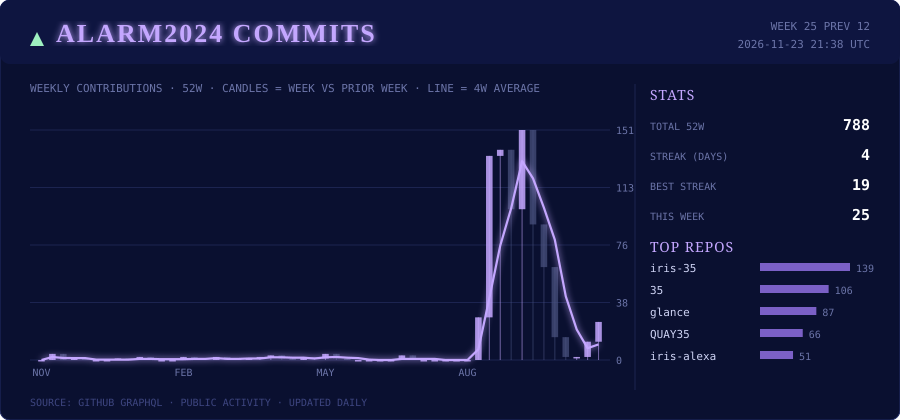

  
  

Photos: <a href="https://www.pexels.com/photo/lake-and-mountain-417074/">James Wheeler</a> · <a href="https://www.pexels.com/photo/snowy-mountain-1287145/">eberhard grossgasteiger</a> (Pexels License)

Solo builder. Small, honest tools on Solana: if a tool can't prove something, it says UNKNOWN.

## Projects

| Project | What it is |
| --- | --- |
| [stale](https://github.com/Alarm2024/stale) | Solana RPC freshness checker (Go, open source). |
| [Stocklana Peg Watch](https://alarm2024.github.io/Stocklana/) | Tokenized-stock peg monitor, submitted to the Stocklana hackathon. |
| [Iris](https://github.com/Alarm2024/iris-35) | Phone-first "what did this transaction do?" safety check, 6 languages. |
| [Oracle Truth](https://github.com/Alarm2024/oracle-truth) | Pre-trade safety gate for perps and prediction markets (in progress). |
| [glance](https://github.com/Alarm2024/glance) | Honest status layer for bot operators. |

## How I work

- UNKNOWN is never 0.
- Outside reviews welcome.
- AI-assisted work is labelled as such.

## Contact

[LinkedIn](https://www.linkedin.com/in/wyndhamheaven)
